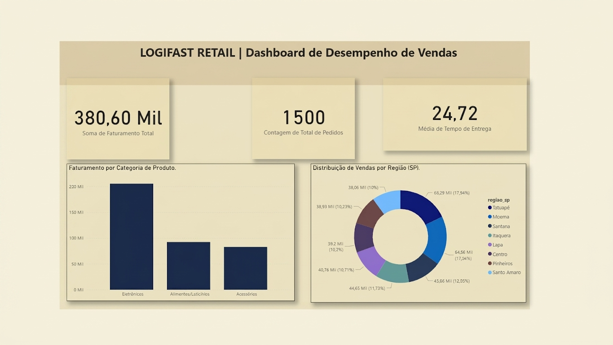

# 🚀 LogiFast Retail — Dashboard de Desempenho de Vendas e Operações


---

## 📌 Sobre o Projeto
O **LogiFast Retail** é uma solução analítica end-to-end desenvolvida para simular e resolver desafios operacionais e de vendas no setor de varejo logístico. 

O objetivo do projeto é construir um pipeline completo de dados — desde a geração e ingestão automatizada até a modelagem dimensional (*Star Schema*) e a criação de um dashboard executivo minimalista de alta performance no Power BI.

---

## 🏗️ Arquitetura do Pipeline de Dados

```text
[ Ingestão & ETL (Python) ] ──► [ Banco Relacional (MySQL) ] ──► [ Visualização Executiva (Power BI) ]
```

Ingestão & ETL (Python):

Script automatizado utilizando pandas, numpy, sqlalchemy e pymysql.

Simulação e estruturação de 1.500 registros de vendas com garantia de reprodutibilidade e integridade relacional.

Tratamento de datas, cálculo de SLA de entrega e padronização de campos comerciais.

Modelagem Dimensional (MySQL):

Estrutura baseada em Star Schema (Esquema Estrela) para otimização de consultas analíticas.

Tabela Fato: fato_vendas (Métricas de faturamento, quantidade, status e SLA).

Tabelas Dimensão: dim_clientes e dim_produtos.

## 📷 Interface do Dashboard



Data Visualization (Power BI):

Layout estilizado em conceito Modern SaaS / Minimalist (fundo tom creme/off-white com contraste em cartões flutuantes e azul marinho profundo).

Foco na experiência do usuário (UI/UX) e na redução do ruído visual para tomada de decisão rápida.
